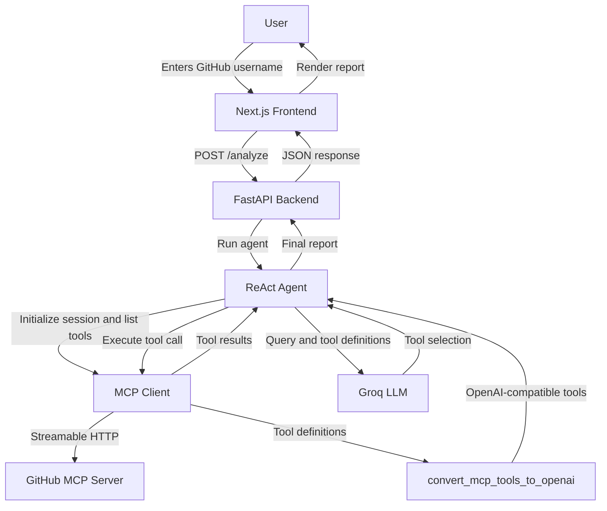

# GitScope

GitScope is an AI-powered GitHub developer profile and repository analysis application. Enter a public GitHub username and GitScope retrieves the developer's repositories through GitHub's Model Context Protocol (MCP) server, then uses a Groq-hosted LLM to reason over the retrieved information and generate a consolidated report covering languages, technical interests, and areas of expertise.

The goal is to make a developer's public technical background easier to understand from their GitHub activity.

## Table of Contents

- [Overview](#overview)
- [Key Features](#key-features)
- [Technology Stack](#technology-stack)
- [System Architecture](#system-architecture)
- [Project Structure](#project-structure)
- [Prerequisites](#prerequisites)
- [Environment Variables](#environment-variables)
- [Installation and Setup](#installation-and-setup)
- [API Documentation](#api-documentation)
- [Agent Workflow](#agent-workflow)
- [GitHub MCP Integration](#github-mcp-integration)
- [Current Limitations and Future Improvements](#current-limitations-and-future-improvements)
- [Security Considerations](#security-considerations)
- [Contributing](#contributing)
- [License](#license)

## Overview

GitScope is a two-part application:

- A **Next.js frontend** that provides a landing page and a GitHub username form. After a submission, it calls the backend and renders the generated analysis report inline.
- A **FastAPI backend** that opens a session with the remote GitHub MCP server, exposes the available MCP tools to a Groq-hosted LLM in OpenAI-compatible function-calling format, and runs a custom ReAct-style loop until the model produces a final report.

Only publicly available GitHub data is intended to be analyzed. GitScope does not require or expect access to private repositories, and the GitHub MCP endpoint used by the backend is a read-only endpoint.

## Key Features

### Implemented

- **GitHub developer analysis** — submit a GitHub username and receive an AI-generated analysis of that developer's public profile and repositories.
- **Repository discovery** — the agent can call GitHub MCP tools to search for repositories associated with the requested user.
- **Technology and language identification** — the LLM derives languages and technical areas from the repository information returned by the MCP tools.
- **AI-powered insights** — Groq generates a consolidated, readable report from the gathered evidence.
- **MCP tool integration** — tools are discovered at runtime from the GitHub MCP server rather than being hard-coded.
- **ReAct agent** — a custom Python loop lets the LLM select tools, observe results, and continue until it produces a final answer.
- **Web interface** — a Next.js App Router frontend with client-side username validation, a loading state, error handling, and an inline report display.
- **Operational endpoints** — the backend exposes a root endpoint and a health check in addition to the analysis endpoint.

### Planned / Not Implemented

The following are not implemented in the current codebase:

- Commit-history analysis.
- README or source-code analysis as part of the standard analysis flow.
- Automatic framework detection beyond what the LLM can infer from the repository metadata returned by MCP tools.
- Caching of repeated analyses, request queuing, authentication, persistence, or rate limiting.
- Production deployment configuration.

The backend contains `get_user_repositories` and `get_repository_readme` helpers in `backend/github_mcp/mcp_client.py`, but the `/analyze` endpoint does not call them directly; the analysis flow relies on runtime tool selection by the LLM.

## Technology Stack

### Frontend

| Technology | Details |
| --- | --- |
| Next.js | `16.4.3`, App Router |
| React | `19.3.0` |
| TypeScript | `^5`, strict mode |
| Tailwind CSS | `v4`, compiled through `@tailwindcss/turbopack` |
| Fonts | Sora, Manrope, and JetBrains Mono via `next/font/google` |
| Linting | ESLint 9 with `eslint-config-next` |

The frontend uses a dark theme defined with Tailwind CSS v4 theme variables in `frontend/app/globals.css`.

### Backend

| Technology | Details |
| --- | --- |
| Python | `>=3.13` (`backend/.python-version` pins `3.13`) |
| FastAPI | Application framework and request validation |
| Uvicorn | ASGI development server |
| Pydantic | Request schema and validation (via FastAPI) |
| httpx | Async HTTP client used for the MCP transport |
| python-dotenv | Environment variable loading |
| uv | Dependency and environment management |

### AI and Agent

- **Groq API** accessed through the OpenAI-compatible Python SDK (`AsyncOpenAI` with the Groq base URL).
- **Model:** `openai/gpt-oss-120b`.
- **Agent:** a custom ReAct-style tool-calling loop implemented in `backend/llm/agent.py`. It does not use LangChain or LangGraph.

### MCP Integration

- Official Python MCP SDK (`mcp`).
- GitHub Remote MCP Server at `https://api.githubcopilot.com/mcp/readonly`.
- Streamable HTTP transport via `mcp.client.streamable_http.streamable_http_client`.
- Bearer-token authentication using `GITHUB_TOKEN`.

## System Architecture

The analysis flow is:

1. The user enters a GitHub username in the Next.js frontend.
2. The frontend validates the username and sends an HTTP `POST` request to the FastAPI backend at `/analyze`.
3. FastAPI receives the request and invokes the custom agent in `backend/llm/agent.py`.
4. The agent obtains the available MCP tool definitions from the GitHub MCP session.
5. `convert_mcp_tools_to_openai` converts the MCP tool schemas into the OpenAI-compatible function-calling format.
6. Groq receives the user's query together with the available tool definitions.
7. The LLM selects one or more GitHub MCP tools to call.
8. The MCP client executes the selected tools against the GitHub MCP server.
9. Tool results are appended to the conversation and returned to the LLM.
10. The loop repeats until the LLM produces a final response or the maximum iteration count is reached.
11. FastAPI returns the generated report as JSON.
12. The frontend displays the report to the user.



## Project Structure

```text
GitScope/
├── backend/
│   ├── github_mcp/
│   │   ├── mcp_client.py
│   │   ├── mcp_executor.py
│   │   └── mcp_tools.py
│   ├── llm/
│   │   ├── agent.py
│   │   ├── llm_client.py
│   │   ├── test_agent.py
│   │   ├── test_llm.py
│   │   └── test_react.py
│   ├── .gitignore
│   ├── .python-version
│   ├── main.py
│   ├── pyproject.toml
│   ├── README.md
│   └── uv.lock
├── frontend/
│   ├── app/
│   │   ├── globals.css
│   │   ├── icon.svg
│   │   ├── layout.tsx
│   │   └── page.tsx
│   ├── components/
│   │   ├── forms/
│   │   │   └── UsernameForm.tsx
│   │   ├── layout/
│   │   │   ├── Footer.tsx
│   │   │   ├── MobileMenu.tsx
│   │   │   └── Navbar.tsx
│   │   ├── sections/
│   │   │   ├── About.tsx
│   │   │   ├── Features.tsx
│   │   │   ├── Hero.tsx
│   │   │   └── HowItWorks.tsx
│   │   └── ui/
│   │       ├── Button.tsx
│   │       ├── Container.tsx
│   │       └── SectionHeading.tsx
│   ├── lib/
│   │   ├── constants.ts
│   │   └── validation.ts
│   ├── types/
│   │   └── index.ts
│   ├── AGENTS.md
│   ├── eslint.config.mjs
│   ├── next-env.d.ts
│   ├── next.config.ts
│   ├── package.json
│   ├── package-lock.json
│   ├── README.md
│   └── tsconfig.json
├── .vscode/
├── LICENSE
└── README.md
```

### Important Modules

| Path | Purpose |
| --- | --- |
| `backend/main.py` | FastAPI application. Defines the CORS middleware, request schema, root and health endpoints, and the `/analyze` endpoint that opens the MCP session, lists tools, and runs the agent. |
| `backend/llm/agent.py` | Custom ReAct agent. Contains tool selection, tool execution, message construction, the Groq call helper, and the bounded agent loop (`max_iterations = 8`). |
| `backend/llm/llm_client.py` | Creates a shared `AsyncOpenAI` client pointed at Groq and defines the model name and a small `ask_llm` helper. |
| `backend/github_mcp/mcp_client.py` | Defines the `github_mcp_session` async context manager (HTTP client, streamable HTTP transport, `ClientSession` initialization) plus development helpers for fetching repositories and README files. |
| `backend/github_mcp/mcp_tools.py` | Converts MCP tool definitions into OpenAI-compatible function definitions. |
| `backend/github_mcp/mcp_executor.py` | Executes an MCP tool by name with JSON arguments and flattens the MCP content blocks into a single text string. |
| `backend/llm/test_llm.py` | Standalone script that sends a prompt to Groq and prints the response. |
| `backend/llm/test_agent.py` | Standalone script that exercises tool selection and execution for a sample query. |
| `backend/llm/test_react.py` | Standalone script that runs the full agent loop for a sample query. |
| `frontend/components/forms/UsernameForm.tsx` | Client component that validates the username, calls `${NEXT_PUBLIC_API_URL}/analyze`, manages loading and error states, and renders the returned report. |
| `frontend/lib/validation.ts` | Shared client-side GitHub username validation rules. |
| `frontend/lib/constants.ts` | Navigation links, feature copy, workflow steps, and the public repository URL. |
| `frontend/app/page.tsx` | Composes the landing page from the Hero, Features, How It Works, and About sections. |

## Prerequisites

Before running the project, install:

- **Python 3.13 or newer**, as required by `backend/pyproject.toml` (`requires-python = ">=3.13"`).
- **uv**, for installing backend dependencies and running Python commands.
- **Node.js** compatible with Next.js 16 and React 19. Node.js 20.9 or newer is recommended; no `.nvmrc` or `engines` field is present in the repository.
- **npm**, which is used for frontend dependencies and scripts.
- **Git**, for cloning the repository.
- A **GitHub Personal Access Token** with access to the public GitHub MCP server. Create one from your GitHub account settings.
- A **Groq API key**. Create one from the Groq console.

API keys must be obtained from their respective official services. Never commit real tokens or keys to this repository.

## Environment Variables

### Backend `.env`

Create `backend/.env` with:

```env
GITHUB_TOKEN=your_github_personal_access_token
GROQ_API_KEY=your_groq_api_key
```

| Variable | Purpose |
| --- | --- |
| `GITHUB_TOKEN` | Bearer token used to authenticate with the GitHub MCP server. If missing, `github_mcp_session` raises a `ValueError`. |
| `GROQ_API_KEY` | API key used by the OpenAI-compatible client to call Groq. |

### Frontend `.env.local`

Create `frontend/.env.local` with:

```env
NEXT_PUBLIC_API_URL=http://127.0.0.1:8000
```

| Variable | Purpose |
| --- | --- |
| `NEXT_PUBLIC_API_URL` | Base URL of the FastAPI backend. The form posts to `${NEXT_PUBLIC_API_URL}/analyze`. Only variables that are safe to expose to the browser should use the `NEXT_PUBLIC_` prefix. |

The repository does not currently include `.env.example` or `.env.local.example` files. If you add them, keep them free of real values.

### Security Notes

- Never commit `.env` or `.env.local`. Both are excluded by the existing `.gitignore` rules (`backend/.gitignore` ignores `.env` and `.env.*`; `frontend/.gitignore` ignores `.env*`).
- Never expose `GITHUB_TOKEN` or `GROQ_API_KEY` to frontend code or the browser.
- Only the public backend URL belongs in a `NEXT_PUBLIC_` variable.

## Installation and Setup

### Step 1: Clone the repository

```bash
git clone https://github.com/Chrisbin19/GitScope.git
cd GitScope
```

### Step 2: Backend setup

```bash
cd backend
uv sync
```

Create `backend/.env` and add your credentials:

```env
GITHUB_TOKEN=your_github_personal_access_token
GROQ_API_KEY=your_groq_api_key
```

Start the FastAPI server:

```bash
uv run uvicorn main:app --reload
```

Run this command from the `backend` directory so that `main:app` resolves. The server listens on `http://127.0.0.1:8000` by default.

### Step 3: Frontend setup

In a second terminal:

```bash
cd frontend
npm install
```

Create `frontend/.env.local`:

```env
NEXT_PUBLIC_API_URL=http://127.0.0.1:8000
```

Start the Next.js development server:

```bash
npm run dev
```

### Step 4: Access the application

Both the frontend and backend servers must be running.

| Service | URL |
| --- | --- |
| Frontend | http://localhost:3000 |
| Backend | http://127.0.0.1:8000 |
| FastAPI Swagger UI | http://127.0.0.1:8000/docs |

The backend CORS configuration currently allows requests from `http://localhost:3000` only. Use that origin for the frontend during local development, or update the allowed origins in `backend/main.py` if you serve the frontend elsewhere.

### Frontend Scripts

```bash
npm run dev    # Start the development server
npm run build  # Create a production build
npm run start  # Serve the production build
npm run lint   # Run ESLint
```

### Optional Development Scripts

The files `backend/llm/test_llm.py`, `backend/llm/test_agent.py`, and `backend/llm/test_react.py` are standalone scripts, not an automated test suite. They can be run directly from the `backend` directory:

```bash
uv run python -m llm.test_llm
uv run python -m llm.test_agent
uv run python -m llm.test_react
```

They require valid environment credentials and make real network requests to Groq and GitHub.

## API Documentation

### GET /

Returns a welcome message.

```json
{ "message": "Welcome to GitScope API" }
```

### GET /health

Returns the service health status.

```json
{ "status": "healthy" }
```

### POST /analyze

Analyzes a GitHub developer profile. This endpoint opens a GitHub MCP session, discovers the available tools, and runs the agent until it produces a report.

**Request**

- Content type: `application/json`
- Body field `username` is required (string).

```json
{
  "username": "torvalds"
}
```

Validation rules from the Pydantic schema:

- Length between 1 and 39 characters.
- Must match `^[A-Za-z0-9](?:[A-Za-z0-9-]{0,37}[A-Za-z0-9])?$`.
- Must not start or end with a hyphen.

**Success response**

```json
{
  "success": true,
  "username": "torvalds",
  "report": "AI-generated GitHub developer analysis..."
}
```

| Field | Description |
| --- | --- |
| `success` | `true` when the analysis completed. |
| `username` | The username that was analyzed. |
| `report` | The final text generated by the agent. |

**Errors**

- `422 Unprocessable Entity` — the request body is missing `username` or fails schema validation.
- `500 Internal Server Error` — the analysis failed (for example, an MCP connection, authentication, or LLM error). The response detail is the generic message `Failed to analyze GitHub profile.`; details are logged on the server only.

```bash
curl -X POST http://127.0.0.1:8000/analyze \
  -H "Content-Type: application/json" \
  -d "{\"username\":\"torvalds\"}"
```

## Agent Workflow

GitScope implements its own ReAct-style loop in `backend/llm/agent.py`. No agent framework is used.

1. **Tool discovery** — `mcp_client.github_mcp_session` initializes a `ClientSession`, and `main.py` calls `session.list_tools()`.
2. **Schema conversion** — `convert_mcp_tools_to_openai` maps each MCP tool's `name`, `description`, and `input_schema` to an OpenAI function definition.
3. **First LLM call** — `run_agent` sends the user query and tool definitions to Groq with `tool_choice="auto"`.
4. **Tool selection** — the model responds with zero or more tool calls, or with a final text answer.
5. **Tool execution** — `execute_and_return_results` records the assistant tool-call message and executes each requested tool through `execute_mcp_tool`.
6. **Observation** — each tool result is added to the conversation with its `tool_call_id`, converting MCP content blocks to plain text.
7. **Iteration** — the updated conversation is sent back to Groq. The loop repeats until the model returns no tool calls.
8. **Termination** — the loop is capped at 8 iterations. If the cap is reached, the agent returns `Maximum agent iterations reached.`

Simplified flow:

```text
User Query -> LLM -> Tool Selection -> MCP Execution -> Tool Results -> LLM -> Final Report
```

The endpoint wraps this flow in the MCP session context, so the connection is closed after the report is generated.

## GitHub MCP Integration

GitScope communicates with GitHub through the remote GitHub MCP server.

- **Endpoint:** `https://api.githubcopilot.com/mcp/readonly` (defined as `GITHUB_MCP_URL` in `backend/github_mcp/mcp_client.py`).
- **Transport:** Streamable HTTP using `streamable_http_client`.
- **HTTP client:** `httpx.AsyncClient` with a 30-second connect timeout and a 300-second read timeout.
- **Authentication:** `Authorization: Bearer <GITHUB_TOKEN>`.
- **Session lifecycle:** `github_mcp_session` is an async context manager that opens the HTTP client and transport, creates a `ClientSession`, calls `session.initialize()`, and yields the session.
- **Tool discovery:** `session.list_tools()` returns the tool definitions exposed by the read-only GitHub MCP server.
- **Tool invocation:** `session.call_tool(name=..., arguments=...)` is used by `execute_mcp_tool`.
- **Response handling:** errors reported via `result.is_error` raise a `RuntimeError`. Content blocks with a `text` attribute are joined into a single string; other blocks are stringified.

The MCP client module also includes helper functions for direct calls such as `search_repositories` and `get_file_contents`, used for development and experimentation.

## Current Limitations and Future Improvements

### Current Limitations

- Analysis depends on the tools the LLM chooses and on the repository metadata returned by the read-only MCP server. It is not a full source-code audit.
- The report is returned as plain text. The frontend preserves whitespace but does not render rich Markdown or structured sections.
- Each request creates a new MCP session and a new LLM conversation; there is no caching or persistence.
- There is no authentication, rate limiting, or request queueing on the backend.
- The backend allows only `http://localhost:3000` through CORS.
- The `test_*.py` files are manual scripts and there is no automated test suite.
- A missing or invalid `GITHUB_TOKEN` or `GROQ_API_KEY` results in a generic `500` response.

### Future Improvements

These are ideas only and are not implemented:

- More detailed repository analysis and richer technology/framework identification.
- README and source-code analysis as part of the standard flow.
- Commit-history and contribution-pattern analysis.
- Richer visualizations and developer statistics.
- Structured, well-formatted report rendering in the UI.
- Improved error handling, request timeouts, and retry behavior.
- Caching frequently requested profile analyses.
- More advanced agent orchestration and tool-use strategies.
- Deployment configuration and production hardening.

## Security Considerations

- GitHub and Groq credentials are stored on the backend in `backend/.env` and are never sent to the browser.
- Do not place secrets in any `NEXT_PUBLIC_` variable. Only the backend base URL should be public.
- `backend/.gitignore` and `frontend/.gitignore` exclude environment files; keep them that way and never commit credentials.
- The backend currently allows only `http://localhost:3000`. In production, restrict CORS to trusted frontend origins.
- Only public GitHub data is intended to be analyzed. The MCP endpoint used is the read-only GitHub MCP server.
- API errors return a generic message to clients. Detailed errors are logged server-side and should not expose secrets or internal implementation details.
- The frontend validates usernames before sending requests, but the backend performs authoritative validation through its Pydantic schema.

## Contributing

1. Fork the repository.
2. Create a feature branch:
   ```bash
   git checkout -b feature/your-feature-name
   ```
3. Implement your changes and verify them locally (run `npm run lint` for frontend changes and test the backend endpoints).
4. Commit your changes and open a pull request describing the problem and the solution.

Please keep pull requests focused and avoid committing credentials or generated environment files.

## License

This project is licensed under the MIT License. See [LICENSE](LICENSE) for the full text.

Copyright (c) 2026 Chrisbin Sibi.
